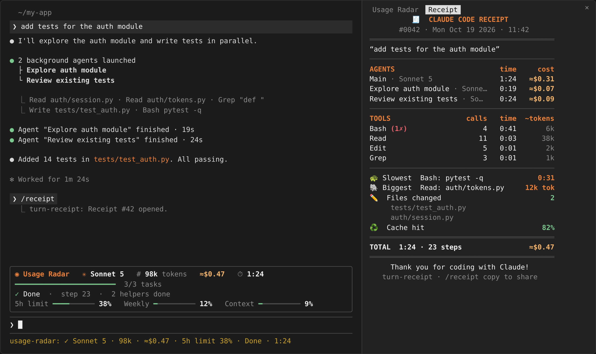

# claude-mods

Little mods I've made for Claude Code. Free to use, MIT licensed.



<sub>usage-radar at the bottom while Claude works, turn-receipt on the right when it's done.</sub>

## What's here

**[usage-radar](./usage-radar)**: a live readout while Claude works. Model, tokens, cost, a timer, how full the context is, and your 5-hour / weekly limits if your plan reports them. It pops a warning at 80% and 95%. `/radar` opens a panel with every agent and what each one is costing you.

**[turn-receipt](./turn-receipt)**: when a job finishes you get a receipt. Which agents ran, how long each took, what they cost, which tools were used, the slowest step, the biggest file read, cache hit rate. `/receipt` to look at it, `/receipt copy` to paste it somewhere.

They work fine together. Radar is for *during*, receipt is for *after*.

## Install

In Claude Code:

```
/plugin install usage-radar --marketplace Tejas274/claude-mods
/plugin install turn-receipt --marketplace Tejas274/claude-mods
```

Say `y` when it asks to add the marketplace and pick **user** so it's on in every project. Restart Claude Code.

Or from a terminal:

```bash
claude plugin marketplace add Tejas274/claude-mods
claude plugin install usage-radar@claude-mods --scope user
claude plugin install turn-receipt@claude-mods --scope user
```

To update later: `/plugin` → Marketplaces → update `claude-mods`. To remove one: `/plugin uninstall <name>`.

You need a recent Claude Code; mods are a new feature.

## What's a mod, anyway?

A small TypeScript file that hooks into Claude Code's events (you sending a prompt, Claude running a tool, an agent finishing) and can watch them, change them, block them, or draw something on screen. These two only watch. Nothing leaves your machine.

## Making your own

There's a starter in [`template/`](./template). Copy it, rename it, change the name in `.claude-plugin/plugin.json`, then:

```bash
claude --plugin-dir ./my-mod      # reloads every time you save
claude plugin validate my-mod
claude plugin test my-mod
```

When it works, add it to `.claude-plugin/marketplace.json` and run `./publish.sh "add my-mod"`.

Issues and PRs welcome.
