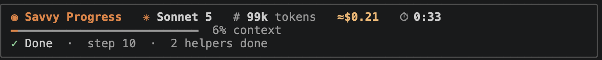

# Savvy Progress

**See what Claude is doing, what it costs, and how long it takes, live, right in your terminal.**




## Install

Inside Claude Code:

```
/plugin install savvy-progress --marketplace Tejas274/claude-mods
```

Answer `y` to add the marketplace, choose **user** scope (all your projects), and restart Claude Code.

Or from your terminal, in one line:

```bash
claude plugin marketplace add Tejas274/claude-mods && claude plugin install savvy-progress@claude-mods
```

## What you get

| Where | What it shows |
|---|---|
| **Band above the prompt** | Model · tokens · cost · timer, a progress bar (Claude's to-do list, or how full the context is), and what Claude is doing right now |
| **Status line** | The same in one line: `⠹ Sonnet 5 · 2 helpers · 94k · ≈$0.41 · Bash: npm test · 0:42` |
| **Agents panel** (`/savvy`) | Cost, tokens and time for the job, plus one row per agent (main + every helper) with its model, context, time taken and cost |
| **Pop-up** | `✓ All done in 1:24 · 3 agents · 14 steps · ≈$0.53` when the whole job, helpers included, is finished |

The panel opens by itself when Claude starts a helper agent. Type `/savvy` to open it any time.

## How the numbers work

- **Cost** is this job's real cost, from the same figures as `/cost`. The panel also shows the session total.
- **Per-agent cost** is an estimate (≈): the job's cost split by each agent's share of the work (tokens, weighted by model price).
- **Tokens** is how much each agent currently holds in its context.
- **Time** runs from your prompt until Claude and every helper agent are done.

## Privacy

Savvy Progress only reads Claude Code's own session numbers (model, token usage, cost, tool names). It stores nothing outside the session and sends nothing anywhere.

## Uninstall

```
/plugin uninstall savvy-progress
```

## Develop

```bash
claude --plugin-dir ./savvy-progress   # run it; saving a file reloads it
claude plugin validate savvy-progress  # check it loads
claude plugin test savvy-progress      # run the tests
```

The code is in [`hooks/register.tsx`](hooks/register.tsx), in four sections: State, Helpers, Hooks, Drawing.

## License

MIT
