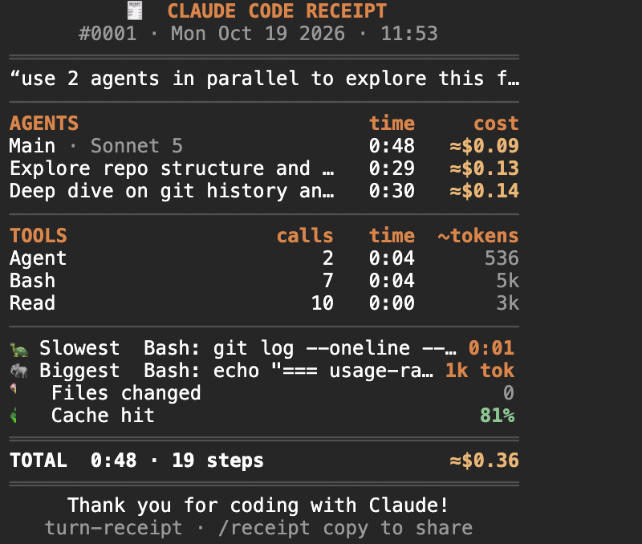

# turn-receipt 🧾

After every job, Claude Code prints you a receipt. Which agents ran and what each cost, which tools got used and how long they took, the slowest step, the biggest read, the files it changed, and how much came from cache.



## Install

```
/plugin install turn-receipt --marketplace Tejas274/claude-mods
```

Pick **user** scope, restart Claude Code. Or: `claude plugin marketplace add Tejas274/claude-mods && claude plugin install turn-receipt@claude-mods --scope user`

## Using it

When a job is done (including any helper agents still running in the background) you'll get a toast like `🧾 Receipt #1 · 0:48 · 19 steps · 3 agents · ≈$0.36`.

- `/receipt`: open it
- `/receipt copy`: copy it as plain text, handy for Slack or a PR description

## What's on it

- **Agents**: each one, its model, how long it ran, its share of the cost
- **Tools**: calls, total time, and roughly how much text each tool fed back to Claude. Failed calls are marked in red.
- **Slowest / Biggest**: usually the first thing worth looking at when a job felt slow or pricey
- **Files changed**, **cache hit %**, and the **total**

Bookkeeping stuff (spawning helpers, to-do updates) is left out of slowest/biggest so they point at real work.

## Notes

- The total is the real cost for the job (same source as `/cost`), when Claude Code reports one. Per-agent costs are an estimate.
- "~tokens" per tool is a rough size estimate (about 4 characters per token).
- Nothing is sent anywhere. `/receipt copy` only touches your clipboard.

## Hacking on it

```bash
claude --plugin-dir ./turn-receipt
claude plugin test turn-receipt
```

MIT
