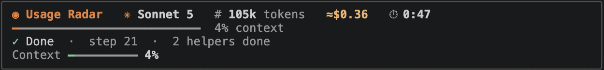
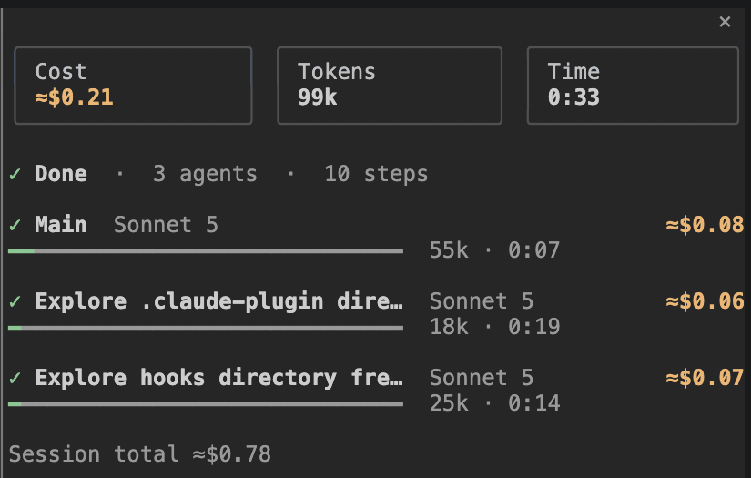

# usage-radar

shows what's going on while claude works, right above the prompt.



install (inside claude code):

```
/plugin install usage-radar --marketplace Tejas274/claude-mods
```

say `y`, pick user scope, restart. or from the terminal: `claude plugin marketplace add Tejas274/claude-mods && claude plugin install usage-radar@claude-mods --scope user`

### what you get

the band above the prompt has the model, and the tokens, cost and time for the whole session so far. under that is the session's name and a dim `this request: ≈$0.01 · 46k · 0:42 · 3 steps` line for just the prompt you're on. then what claude is doing right now, and meters for context and the 5h/weekly limits (only if your account reports them, mine only shows context).

the session name is your `/rename` name if you gave one. otherwise it's a ticket ID from your first prompt (like `MRKRR-142`), otherwise the first 5 words of that prompt.

when a meter goes past 80% you get a little warning, and again at 95%. for context it tells you to `/compact`.

the status line at the bottom gets a short version of all that.

`/radar` opens a panel: the session name, cost / tokens / time for the session plus the "this request" line, the limits with when they reset, and one row per agent with its own cost. helper rows read `type · description` (like `Explore · Find the config`), teammates show their name. it also opens on its own when claude starts helper agents. on a wide terminal it docks on the right.



### about the numbers

context and limits come straight from claude code. the cost is the real one (same as `/cost`), the per-agent split is an estimate so it has a ≈. the timer keeps going until the helpers finish too, not just the main agent.

tokens are new tokens: input + cache writes + output. cache reads aren't counted, because every step re-reads the same history from the cache and counting it again each time would blow the number up. so it won't match the context size.

time is working time: from your prompt until every agent is done. idle gaps between prompts don't count. each helper agent is counted once per session.

totals are saved per session in the mod's own local store, so `claude --resume` (even days later) carries on from where you left off. `/clear` starts fresh. sessions you haven't used for 90 days are pruned. the store also holds the session name, which can be the first 5 words of your first prompt.

it only reads claude code's own numbers, nothing is sent anywhere.

### changelog

- 2.1.0 session totals that survive --resume, session name, agent names, theme colours
- 2.0.0 renamed from savvy-progress, added context + limit meters and the warnings
- 1.2.0 panel grows to fit all the agents
- 1.1.0 timer waits for background helpers, new colours
- 1.0.0 first version

code is all in `hooks/register.tsx`. to hack on it: `claude --plugin-dir ./usage-radar`.

MIT
