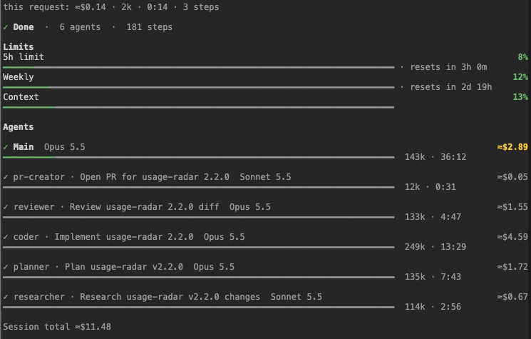
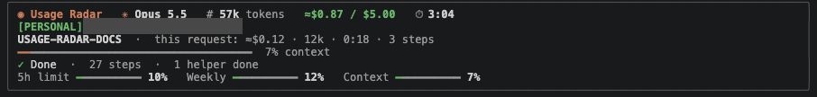
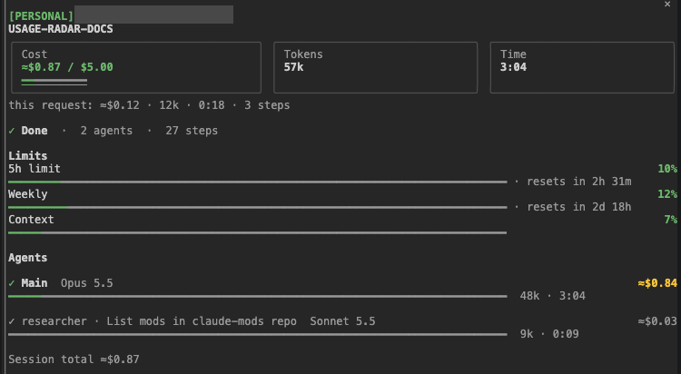
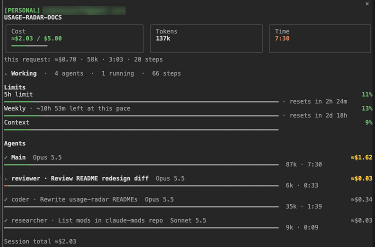
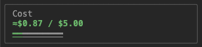
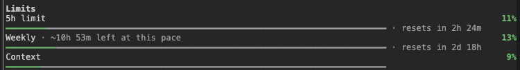
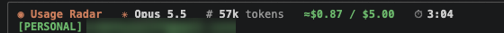

# usage-radar



*Real session: building usage-radar 2.2.0 with a 5-agent pipeline*

live usage, cost and limits right above the prompt while claude works, plus what each agent costs.

### quick install

from the terminal:

```bash
claude plugin marketplace add Tejas274/claude-mods
claude plugin install usage-radar@claude-mods --scope user
```

or inside claude code: `/plugin install usage-radar --marketplace Tejas274/claude-mods`, say `y`, pick user scope, restart.

### what you get

#### the band



the band above the prompt has the model, and the tokens, cost and time for the whole session so far. under that is the session's name and a dim `this request: ≈$0.01 · 46k · 0:42 · 3 steps` line for just the prompt you're on. then what claude is doing right now, and meters for context and the 5h/weekly limits. the 5h/weekly limits show up after claude's first response, if your plan reports them.

when a meter goes past 80% you get a little warning, and again at 95%. for context it tells you to `/compact`.

the session name is your `/rename` name if you gave one. otherwise it's a ticket ID from your first prompt (like `DEMO-42`, also from a jira `/browse/` link; things like `step-2` or `python-3` aren't tickets), otherwise the first 5 words of that prompt.

#### agents panel (`/radar`)



`/radar` opens a panel: the session name, cost / tokens / time for the session plus the "this request" line, the limits with when they reset, and one row per agent with its own cost, tokens and time. helper rows read `type · description` (like `Explore · Find the config`), teammates show their name. an idle teammate shows `idle` and its clock pauses.

it also opens on its own when claude starts helper agents. on a wide terminal it docks on the right.

while a helper runs, its row is bold with a spinner and the finished ones are dimmed:



#### session budget



you can give a session a cost budget: `/radar budget 5` (or `$2.50`). the cost then reads `≈$3.20 / $5.00`, green, amber past 80%, red past 100%, and the panel's cost tile gets a little bar. you get one warning at 80% and one at 100%. `/radar budget` shows where you are, `/radar budget off` turns it off.

the budget is saved with the session so it survives `--resume`, and `/clear` keeps the budget but starts the spend over. want one on every session? set `defaultBudget` (see options).

#### burn-rate forecast



once a limit has been climbing for a few minutes of work, its meter also guesses when you'll hit it at the current pace, like `5h limit ━━━━━━━━━━ 46% · ~1h 10m left` (the panel says `~1h 10m left at this pace`). it only shows while claude is working, and not when the limit resets before you'd hit it anyway. you get a toast when it's under 30 minutes away, and another under 10.

#### account badge



the band and the panel also show which account you're signed in as, like `[WORK] me@example.com`, with your own labels per email domain (see options). `hideEmail` shows just the label. it's read from claude code's own account file (`.claude.json` in your config dir). no email there (an API key, bedrock, vertex)? it shows the organization, or else the config dir like `~/.claude-work`, so you can still tell your setups apart.

#### status line and resume

the status line at the bottom gets a short version of all that.

totals are saved per session, so `claude --resume` (even days later) carries on from where you left off.

### options

set them in `/config`, or in the `settings.json` of each config dir you use (`~/.claude/settings.json`, and e.g. `~/.claude-work/settings.json` if you run a second account with `CLAUDE_CONFIG_DIR`).

| option | what it does | default |
| --- | --- | --- |
| `accounts` | labels per email domain, one entry per account as `domain=LABEL`. subdomains match too | none (just the email) |
| `showAccount` | show the account in the band and the panel | `true` |
| `hideEmail` | show only the label (or the organization), not the email | `false` |
| `defaultBudget` | the budget every new session starts with, in dollars. `0` = none | `0` |

for example, labels for a work and a personal account:

```json
{
  "pluginConfigs": {
    "usage-radar@claude-mods": {
      "options": {
        "accounts": ["work.example.com=WORK", "gmail.com=PERSONAL"]
      }
    }
  }
}
```

(one comma-separated text like `"work.example.com=WORK,gmail.com=PERSONAL"` works too, which is what `claude plugin configure` saves.) `WORK` is amber, `PERSONAL` green, any other label orange. restart claude code after changing settings.json.

### commands

| command | what it does |
| --- | --- |
| `/radar` | open the panel |
| `/radar budget <n>` | set a budget for this session, e.g. `5` or `$2.50` |
| `/radar budget` | show where you are |
| `/radar budget off` | turn it off |

### how the numbers work

<details>
<summary>how the numbers work</summary>

context and limits come straight from claude code. the cost is the real one (same as `/cost`), the per-agent split is an estimate so it has a ≈. the timer keeps going until the helpers finish too, not just the main agent, and it ticks every second while background helpers work after the main turn is over. cost and agent rows refresh about once a second while anything runs.

tokens are new tokens: input + cache writes + output. cache reads aren't counted, because every step re-reads the same history from the cache and counting it again each time would blow the number up. so it won't match the context size.

in the panel, the main row is the session's totals minus what the helpers used. helpers stay listed for the whole session: running ones first, finished ones dimmed with their final numbers, and past 8 rows the older ones share a `+N earlier agents · ≈$X` line (running ones that don't fit show as `+M more running · ≈$Y`).

the forecast only counts working time: how much a limit went up per minute of work over the last 10 minutes of work. a gap of over a minute between readings counts as idle, and whatever a limit went up meanwhile (another session, the web app) is left out. it needs 3 minutes of work before it guesses, and starts over when the limit resets.

time is working time: from your prompt until every agent is done. idle gaps between prompts don't count, nor time when every running agent is an idle teammate. each helper agent is counted once per session.

totals are saved per session in the mod's own local store, so `claude --resume` (even days later) carries on from where you left off. `/clear` starts fresh. sessions you haven't used for 90 days are pruned. the store also holds the session name, which can be the first 5 words of your first prompt.

it only reads claude code's own numbers, nothing is sent anywhere. the account's email and organization are read only to draw the badge: they're never stored or sent.

</details>

### changelog

- 2.2.0 burn-rate forecast for the 5h/weekly limits, session budget (/radar budget) with 80%/100% warnings, account badge with labels
- 2.1.1 timer keeps ticking while background helpers work, live refresh, main row shows session totals, agents kept for the whole session, ticket IDs from Jira links and fewer false ones, teammate names, idle teammates pause their clock
- 2.1.0 session totals that survive --resume, session name, agent names, theme colours
- 2.0.0 renamed from savvy-progress, added context + limit meters and the warnings
- 1.2.0 panel grows to fit all the agents
- 1.1.0 timer waits for background helpers, new colours
- 1.0.0 first version

code is all in `hooks/register.tsx`. to hack on it: `claude --plugin-dir ./usage-radar`.

MIT
